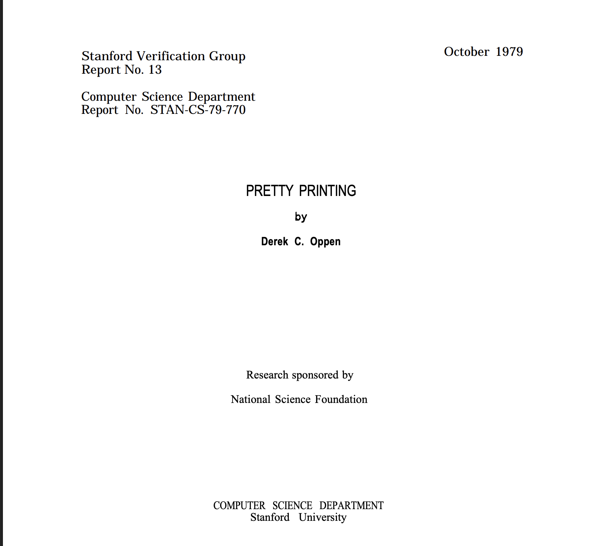
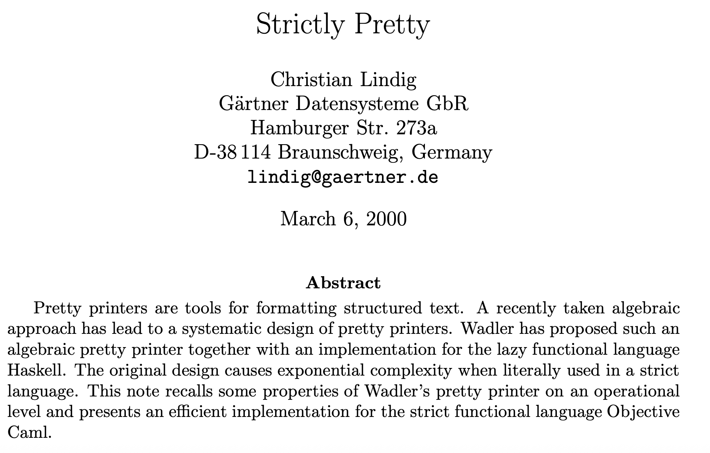
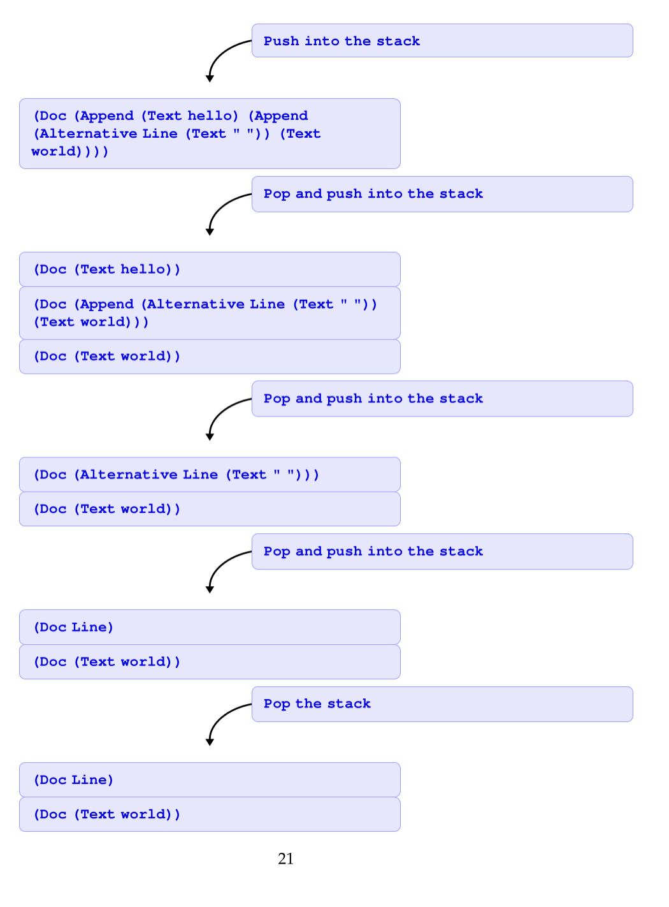

The title means that there is already a functional pretty printer by *Wadler* but even though I use
OCaml the following code is based on Benjamin Pizza's Gutenberg library. The paper that shows the imperative
version is shown below( Derek C. Oppen, "Pretty Printing" (1979)). But I have not ported the code from the paper.

This is a [simplified version](https://github.com/mohanr/agentic-harness/blob/main/lib/console/layout.ml) of the Gutenberg library mentioned above.

# Pretty printer

{:width="10%"}{:class="img-responsive"}

I also discovered a paper that shows Object Caml code which I didn't use. Mine is just an imperative version.

{:width="10%"}{:class="img-responsive"}

## The GADT



(* This GADT is for educational purposes *)
(* and does not use type indexing  *)
type choice_point = {
  fallback : doc option;
  nesting_level : int;
  linebuffer_count : int;
  linetext_length : int;
  flatten : bool;
  can_backtrack : bool;
  mutable resume_at : int;
}
[@@deriving sexp ]

and doc =
  | Empty : doc
  | Line : doc
  | Text : string -> doc
  | Append : doc * doc -> doc
  | Nest : int * doc -> doc
  | Flatten : doc -> doc
  | Choice : doc * doc -> doc
  | Alternative : doc * doc -> doc

and item =
  | Empty_Item : item
  | Doc : doc -> item
  | SetNesting : int -> item
  | EndFlatten : item
  | ChoicePoint : choice_point -> item
[@@deriving sexp ]



The code pushes the terms to a stack and pops them thereby formatting text or code based on
the page width.



let%expect_test "hello world"=
    let type1 = Alternative(Line, (Text " ")) in
    let formatted_doc = Append(Text "hello" , Append(type1 ,( Text "world"))) in
    Printf.printf "%s" (Layout.layout (Doc formatted_doc ));
    [%expect {|
      Pushing (Doc
       (Append (Text hello) (Append (Alternative Line (Text " ")) (Text world))))
      execute [(Doc
       (Append (Text hello) (Append (Alternative Line (Text " ")) (Text world))))]
      Popping (Doc
       (Append (Text hello) (Append (Alternative Line (Text " ")) (Text world))))
      Pushing (Doc (Append (Alternative Line (Text " ")) (Text world)))
      Pushing (Doc (Text hello))
      Popping (Doc (Text hello))
      Popping (Doc (Append (Alternative Line (Text " ")) (Text world)))
      Pushing (Doc (Text world))
      Pushing (Doc (Alternative Line (Text " ")))
      Popping (Doc (Alternative Line (Text " ")))
      Pushing (Doc Line)
      Popping (Doc Line)
      Popping (Doc (Text world))
      hello
      world
      |}]



{:width="10%"}{:class="img-responsive"}

There are some design decisions based on _ChoicePoint_ that I have to explain.
